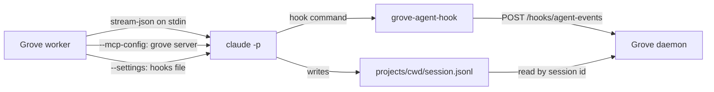

# Claude Code

## Control a Claude Code session from Grove

Grove starts `claude -p` with JSON streaming on stdin and stdout, then holds that connection open between turns. You send messages, interrupt work and answer structured questions without attaching to the terminal UI.

- **A message is confirmed, not assumed.** Every message you send carries an ID, and Grove waits for Claude Code to replay that ID before marking it delivered.
- **Interrupt stops the current turn.** The running tool call ends and its result is rejected, so a long command does not have to finish before you redirect the work.
- **A model change is validated first.** Grove asks the provider to confirm the model before reporting success, and the new model applies from the next turn.
- **Structured questions come to you.** Grove answers `AskUserQuestion` requests from the web dashboard, the TUI or MCP, so a waiting agent does not sit idle until you open its terminal.

## Where Grove reads and writes

Claude Code assembles its own context from its config dir, its settings and the MCP servers it is handed. Grove adds to each without editing anything that is yours.



- **The transcript is Claude Code's own file.** It lands under the config dir in `projects/`, one JSONL per session with sub-agents beside it, and Grove finds it by session id and only ever reads it.
- **The Grove MCP server is passed on the command line**, never written into your `.mcp.json`, and carries the mailbox and API addresses so the agent can write to its peers.
- **Hooks come from a Grove-owned settings file.** Each event runs `grove-agent-hook`, which writes a small sidecar and posts the event to the daemon.
- **The first-turn brief and every reminder arrive as messages**, fenced as Grove instructions, so they read as Grove's words rather than yours.

## What needs the terminal twin instead

Ordinary tool permissions and plan approvals cannot be answered through the native adapter. Pick `claude-terminal` when your workflow depends on those dialogs.

- **Plan approval is a positional dialog.** Approving a plan means choosing one of its rows, which is a decision the interactive UI owns.
- **Permission prompts stay in the agent.** Grove adds no permission gate of its own, so the agent's approval policy still governs every tool call.
- **Pause is unavailable on a native session.** The worker holds the conversation, so use Respawn to recover rather than Pause and Resume.

## Exact status with hooks

Grove derives state from the transcript by default, which is accurate and slightly behind. Managed hooks report each lifecycle change as it happens, so a permission prompt reads as blocked rather than quiet.

```json title=".grove/config.json"
{ "hooks": { "enabled": true } }
```

Grove launches `claude_code` agents with an extra `--settings` file and leaves your own `.claude/settings.json` untouched.

## Configuration

```json title=".grove/config.json"
{
  "agents": [
    { "name": "code-agent", "command": "claude --model claude-opus-4-5", "kind": "claude_code" }
  ]
}
```

A custom named Claude agent must declare `kind: "claude_code"` itself. An omitted `kind` silently defaults to `generic`, which leaves the dashboard with no transcript to read.

## See also

- [Agents](configure-agents.md): choosing between native, headed and headless.
- [Codex](agents-codex.md) and [OpenCode](agents-opencode.md): the other native adapters.
- [Agent activity and sessions](features-activity.md): what the transcript unlocks.
