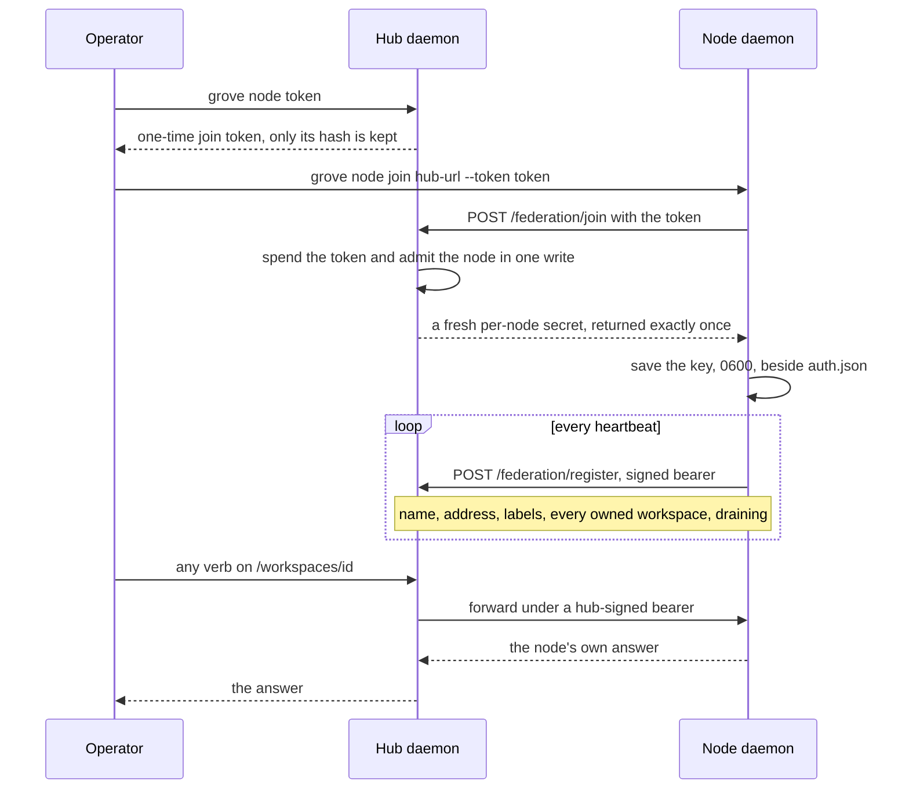

# Federation

## Several machines, one place to ask

Federation puts several Grove daemons behind one hub. The hub knows which nodes exist and which node owns which workspace, and it forwards each workspace verb to its owner. Every node keeps full authority over its own workspaces, so the hub is a phone book, not a landlord.



## Joining and trust { .ms-h2-icon data-icon="target" }

Daemon-to-daemon identity is one shared key per node and nothing else. Logging a person in is a separate concern and plays no part here.

- **A join token works once.** `grove node token` on the hub mints it with an expiry, and only its hash is stored. Spending it and admitting the node are one write, so one token can never admit two nodes.
- **The secret is handed over exactly once.** The node saves it beside `auth.json` with owner-only permissions, and the hub keeps only a digest of it, so the secret a node was given never sits on the hub's disk.
- **Every later call carries a signed bearer.** It is an HMAC over a timestamp and over who the call is for, so a bearer a node sent the hub can never be replayed at the node as if the hub had sent it.
- **Clock skew is bounded, not timed.** A bearer older than `max_clock_skew_seconds` is refused, which bounds replay without anything waiting on it.
- **Revoking a node ends its link.** `grove node forget` on the hub drops the key, the node's next call is refused, and its link stops knocking rather than retrying a key that will never work again.

## Placement { .ms-h2-icon data-icon="route" }

A create sent to the hub lands on one node. The hub picks it by filtering in the order an operator would debug, then by load.

- **The filters run in a fixed order**: the node you named, reachable, not draining, already holds the project, configures the runtime you asked for, carries every selected label, under its declared capacity. A refusal names the filter that left nothing, such as "no node carries labels residency eu", so the message is the fix.
- **The least-loaded node wins**, measured as workspaces over capacity, so a big node and a small one fill evenly. A node with no declared capacity is unbounded.
- **A project is matched by its remote, never its path.** Every clone URL form normalizes to the same name, so the hub places a create only where that project already exists. A repository with no hosted remote cannot be federated, and Grove says so.
- **A project can require labels once.** `scheduling.require` in the project's config sets the default selector, so a repository can say "EU residency only" without every caller repeating it. A create's own selector still wins.
- **The hub is never a candidate once a node has registered**, because it holds metadata, not workspaces. With no nodes at all it is an ordinary daemon and creates locally.

## Choosing a node and a runtime { .ms-h2-icon data-icon="grid" }

A create can name exactly where it runs instead of leaving the choice to the hub. Every node reports the remote runtimes it configures on each heartbeat, so the hub knows which node can run which [runtime](features-runtimes.md).

```bash
grove create feature-x --node build-eu-1          # this node, by name
grove create feature-x --runtime sandbox          # a runtimes.<name> block
grove create feature-x --node build-eu-1 --runtime container
```

- **`--node` pins the create to one connected node.** A node that is out of sight, draining or missing the project refuses with the filter that failed, before anything is forwarded.
- **`--runtime` takes `host`, `container` or the name of a remote runtime block.** On a hub, only a node that configures that block is a candidate.
- **The web composer offers both as pickers.** It lists this daemon first, then each reachable node with the runtimes it reports, and the TUI's create form offers the remote runtimes too. A remote runtime or a node is chosen per create and never saved as a default.
- **Omit both and nothing changes.** The hub picks the least-loaded node that fits, and the node uses its own default runtime.

## Heartbeats, drain and losing sight { .ms-h2-icon data-icon="flow" }

Each heartbeat is a full registration, so the hub's view converges within one beat and a hub restart rebuilds itself from the next round.

- **A hub restart needs no special case.** It keeps only keys on disk, and the next heartbeat from each node puts back everything it forgot.
- **Drain stops new work and keeps running work.** `grove node drain` tells the hub at once, the hub stops placing creates there, and running workspaces finish. `--undo` accepts work again.
- **Unreachable is a state, never an action.** A node that misses heartbeats for `unreachable_after_seconds` is listed as unreachable and nothing is killed. Its workspaces stay where they are.
- **A verb on an unreachable node's workspace says so.** The hub answers with a typed "owner unreachable" naming the node and when it was last seen, which is different from "the hub never heard of it" and takes a different action.
- **A node rides out a lost hub.** Transport failures back off from one second up to `reconnect_ceiling_seconds` and never end the link, and losing the hub costs the node nothing but visibility.

## Commands

| Where | Command | What it does |
|---|---|---|
| Hub | `grove node token` | Mint a one-time join token |
| Node | `grove node join <hub-url> --token <token>` | Exchange it for the node key and register at once |
| Hub | `grove node ls` | Every admitted node, reachable or not |
| Node | `grove node status` | This daemon's role and its hub link |
| Node | `grove node ping` | Check the hub hop by hop: resolve, connect, then the key |
| Node | `grove node drain [--undo]` | Stop or resume accepting new workspaces |
| Node | `grove node reconnect` | Drop the current wait and re-register now |
| Hub | `grove node forget <node-id>` | Revoke a node's key |

`grove node ping` stops at the first hop that fails and prefixes the refusal with the side that refused, so DNS, TLS and a revoked key each read as what they are.

## Configuration { .ms-h2-icon data-icon="plug" }

Federation is off unless a user or machine layer turns it on. A committed project config can never enable it. A block that fails to validate disables federation with one warning rather than stopping the daemon, and `grove federation check` dry-runs the same validation.

```json title="~/.config/grove/config.json"
{
  "federation": {
    "enabled": true,
    "node": {
      "role": "node",
      "name": "build-eu-1",
      "hub_url": "https://hub.example.com",
      "advertise_url": "https://build-eu-1.example.com",
      "join_token_env": "GROVE_JOIN_TOKEN",
      "labels": { "residency": "eu" },
      "capacity": 8
    }
  }
}
```

A project's own placement default lives in its committed config:

```json title=".grove/config.json"
{ "scheduling": { "require": { "residency": "eu" } } }
```

Every field is in the [Configuration Reference](configure-reference.md).

## See also

- [Authentication & Pairing](use-auth.md)
- [Runtimes](features-runtimes.md)
- [CLI](use-cli.md)
