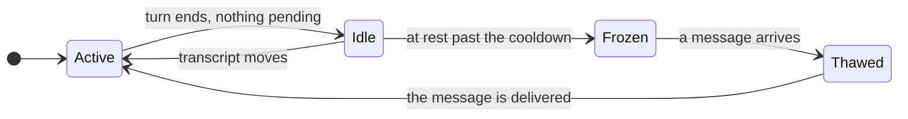

# Idle suspension

## An agent at rest stops costing anything

A workspace whose agent has finished its turn and is waiting for nobody in particular still holds a container's CPU and memory. Grove notices when an agent has been at rest past a cooldown, suspends its runtime in place, and wakes it the moment a message arrives. It works like a laptop lid: close it when nobody is using it, and everything is exactly where you left it when you open it again.



## When a workspace counts as idle { .ms-h2-icon data-icon="target" }

Idle is decided from the agent's own activity, and it is conservative by construction. Anything that suggests work in flight keeps the workspace awake.

- **The agent must be at rest.** Its main session reads as idle or waiting, with no question pending, no sub-agent running and no queued message.
- **A pending question is never idle.** An agent asking a person something reads as blocked, so it is never suspended while it waits for the answer.
- **The transcript must be still for the whole cooldown**, fifteen minutes by default. Any new line resets the clock.
- **A paused or already frozen workspace is skipped**, and so is one whose session cannot be read.
- **Each candidate is confirmed against a fresh reading** before it is frozen, so a stale dashboard view can never freeze an agent that just started working.

## Freeze and thaw { .ms-h2-icon data-icon="flow" }

Freezing is not pausing. A pause drops the worktree and keeps the branch, while a freeze keeps the worktree and the agent's process exactly as they are.

- **A container is paused in place.** Its memory is kept and it uses no CPU, so a thaw is instant and the agent continues mid-session.
- **A host workspace is marked frozen and left as it is.** An agent at rest on the host costs a tmux server and an idle process, and there is nothing to suspend that would pay for the thaw.
- **The next message wakes it.** Sending a message, from the web composer, `grove message`, MCP or a peer's mail, thaws the workspace first and then delivers the message.
- **A frozen workspace reads as idle, not offline.** A paused container looks stopped to Docker, and Grove reports it as idle so the dashboard never suggests a respawn that would throw away a session the next message simply wakes.
- **A dirty worktree is no reason to refuse.** Nothing is discarded by a freeze, so uncommitted work stays exactly where it was.

## How it runs

One host-wide idle check rides the daemon's existing watch scheduler, so it adds no loop of its own. It checks roughly ten times per cooldown, which bounds how late a freeze can land. Each freeze and thaw is recorded on the workspace and emitted as a span when [telemetry](features-telemetry.md) is on. Remote runtimes refuse to freeze until their worker can push the branch first, see [Runtimes](features-runtimes.md).

## Configuration { .ms-h2-icon data-icon="plug" }

```json title=".grove/config.json"
{ "idle": { "cooldown_seconds": 1800 } }
```

The cooldown is at least a minute. Every field is in the [Configuration Reference](configure-reference.md).

## See also

- [Workspace lifecycle](features-workspace-lifecycle.md)
- [Containerized agents](features-containers.md)
- [Status semantics](features-status.md)
