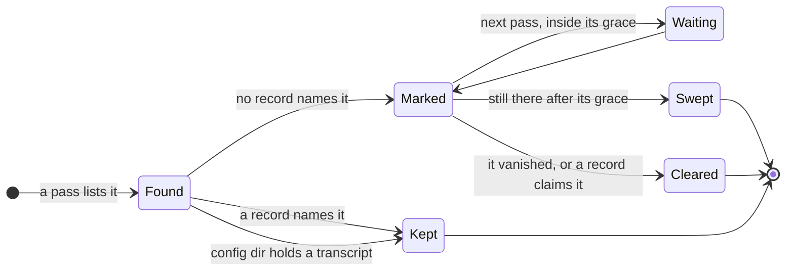

# Reaping

## Clean up what a crash left behind

Every Grove verb cleans up after itself, but a crash, a killed daemon or an interrupted test run can skip that path and leave a tmux server, a worker process or a directory of files that no workspace owns. The reaper is the global pass that catches those leftovers. Think of it as a stocktake: compare what is on the shelves against the ledger, set aside what nobody ordered, and only throw it out if it is still unclaimed next time.



## Mark, wait, sweep { .ms-h2-icon data-icon="flow" }

Nothing is removed the first time it is seen. A leftover is marked, given a grace period, and removed only if a later pass still finds it unclaimed.

- **A pass compares what exists with what the records entitle.** Each resource class has its own collector that lists what is on the host, and the workspace records decide what is accounted for. A collector never reads a record itself.
- **The first sighting is a mark.** It is written to an append-only log, so a daemon restart between the mark and the sweep keeps the original sighting and the grace keeps running.
- **The grace is short for servers and long for files.** Tmux servers and processes wait a minute, and per-workspace files wait a day.
- **The sweep re-checks under the workspace store's lock.** A create saves its record under that same lock before it starts anything, so a workspace being created right now is always either named by the re-read or does not exist yet.
- **A leftover that disappears and later returns starts over.** Its old mark is cleared when it vanishes, so it never inherits a stale grace.

## What is never touched { .ms-h2-icon data-icon="target" }

The reaper is conservative by design. Leaving a leak costs a little disk or memory, and removing the wrong thing costs a live session.

- **Any workspace record entitles its resources, whatever its status.** A running workspace whose server died, a paused one and an errored one all keep what they name.
- **Only what Grove itself started is a candidate.** A process is recognised by the arguments Grove composes for it, a worker's config file or an observer's private socket, never by a name pattern your own process could share. The shared default tmux server is refused outright.
- **A wedged tmux server keeps its socket.** If the server cannot be ended while its socket still accepts connections, something is still alive there, so only a socket that refuses connections counts as stale.
- **A config dir holding a real transcript is kept.** A container's transcripts live in its agent config dir, so a dir with any transcript over 1 KB is listed as kept and never offered for removal. The check runs again at the moment of removal, so a transcript written after the mark still wins.
- **Files outside Grove's own per-workspace directories are out of reach.** Transcripts, the SQLite stores and your config backups are never listed.

## Run it by hand

The daemon runs a pass at start-up and then on its schedule. `grove vacuum` runs the same pass on demand.

```bash
grove vacuum                    # report candidates, change nothing
grove vacuum --apply            # remove what is past its grace
grove vacuum --class tmux       # one class only: tmux, process or files
```

- **A dry run lists everything a pass found**, including candidates still in their grace with when they were first seen and when they become sweepable.
- **Run it twice to remove a leak.** The first pass marks and the second, after the grace, sweeps.
- **It exits 1 whenever anything is marked, waiting or swept**, so a CI job can assert that a host is clean.
- **`grove doctor` shows a leaked-resources row** read from the latest pass. It is informational and never blocks a create.

## Configuration { .ms-h2-icon data-icon="plug" }

The daemon's reaper starts in dry-run mode, so it reports and removes nothing until you turn removal on.

```json title="~/.config/grove/config.json"
{
  "reaper": {
    "enabled": true,
    "interval_seconds": 600,
    "dry_run": false
  }
}
```

`grove vacuum --apply` removes regardless of `dry_run`. Every field is in the [Configuration Reference](configure-reference.md).

## See also

- [Workspace lifecycle](features-workspace-lifecycle.md)
- [Idle suspension](features-idle.md)
- [Watches](features-watches.md)
