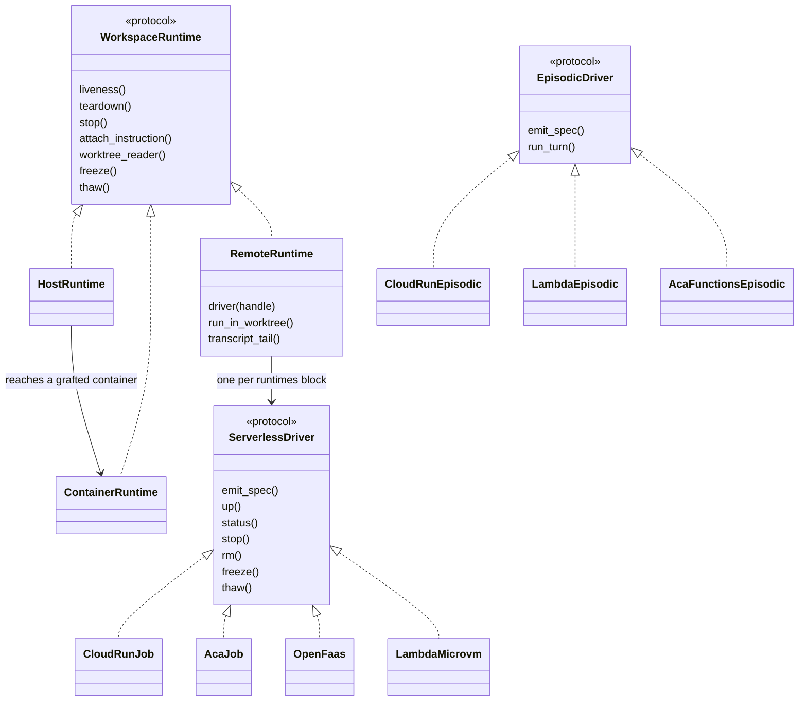

# Runtimes

## Where an agent runs, and who answers for it

A workspace's runtime is the place its agent process lives. Grove knows three: the **host**, a **container** on the host, and a **remote** workload on a serverless platform. Each one answers the same handful of questions after the agent launched, so the rest of Grove never has to ask which kind it is talking to.



## Three runtimes, one set of answers { .ms-h2-icon data-icon="grid" }

Every runtime answers "is it alive", "tear it down", "how do I get in" and "how does a command reach the worktree". The workspace record names its runtime, and that saved value picks the answers, never the current config.

- **Host** runs the agent in its own tmux server on this machine. It has nothing worth suspending, so an idle host workspace simply stays as it is and costs an idle process.
- **Container** runs the agent inside a devcontainer Grove provisioned for the worktree. Freezing it pauses the container in place, so memory survives and a thaw is instant. See [Containerized agents](features-containers.md).
- **Remote** runs the agent on a serverless platform named by a `runtimes.<name>` block. The workload dials this daemon, nothing ever dials in, and its platform handle is saved on the workspace record so a daemon restart loses nothing.
- **A remote worktree is read by asking its worker.** Git status and the task phase travel over the worker's own connection, because that worktree does not exist on this disk.
- **A remote transcript is mirrored to this host as the agent writes it.** The worker follows its own transcript files and sends each new byte over the same connection, and Grove keeps the copy beside the workspace's own agent configuration. The conversation, the todo list, token counts and sub-agent rows then read exactly as they do for a host workspace, and the copy survives the workload. This needs a tool whose transcript is append-only files, which Claude Code and Codex are; OpenCode keeps a database and shows status only.
- **A remote workload that runs but has not dialled in reads as offline**, never as a confident zero. A booting worker is exempt, since it has not had the chance to connect yet.

## Resident and episodic platforms { .ms-h2-icon data-icon="flow" }

A serverless platform either keeps one workload up for the whole life of a workspace, or runs it one turn at a time. Grove models these as two separate driver kinds, because they share almost nothing beyond the deployment document.

- **A resident driver** keeps one long-running container per workspace, like a native worker on a remote machine. It starts, reads, stops, freezes and thaws that workload.
- **An episodic driver** runs nothing between turns. Each turn restores the worktree from the workspace branch, runs exactly one turn, pushes and exits, so an idle episodic workspace costs storage only.
- **An episodic turn must fit in one request.** There is no mid-turn steer, and the only input is the next turn. A turn cut short by the platform's deadline is reported as a failure, never as a turn that finished.
- **Both kinds start from a document you apply.** Grove emits the platform's own deployment spec, your tooling applies it, and Grove only drives executions of what you deployed. Secrets appear in that spec as platform secret references, never as values.
- **A quota or capacity refusal is final.** The platform's no is surfaced on the first answer and never retried, because retrying into an exhausted quota only spends the next request's budget.

| Platform | Kind | Freeze | Thaw | Page |
|---|---|---|---|---|
| Google Cloud Run job | Resident | Cancels the execution | A fresh execution resumes from the branch | [Cloud Run job](runtimes-cloud-run-job.md) |
| Azure Container Apps job | Resident | Stops the execution | A fresh execution resumes from the branch | [Container Apps job](runtimes-aca-job.md) |
| OpenFaaS | Resident | Scales the function to zero | Scales back to one, same function | [OpenFaaS](runtimes-openfaas.md) |
| AWS Lambda MicroVM | Resident | Native suspend, memory kept | Native resume, same MicroVM | [Lambda MicroVM](runtimes-lambda-microvm.md) |
| Cloud Run service | Episodic | Nothing runs between turns | The next turn | [Cloud Run service](runtimes-cloud-run-service.md) |
| AWS Lambda, Azure Functions | Episodic | Nothing runs between turns | The next turn | [Lambda and Azure Functions](runtimes-lambda-azure-functions.md) |
| OpenSandbox | Resident | Pauses the sandbox, memory kept | Resumes the same sandbox | [OpenSandbox](runtimes-opensandbox.md) |

## What works today { .ms-h2-icon data-icon="target" }

A remote workspace is created, read, frozen and respawned through the same verbs as any other. The worker clones your branch and dials back, so nothing has to reach into the platform.

- **Creating a `remote` workspace names its runtime block**, or takes the only one you configured. It is refused before anything starts if the agent is not a native session, `daemon.mailbox_url` is unset or the repository has no remote, because the worker could never dial back.
- **Freeze and stop push the branch first.** If the push fails the workload keeps running and Grove says why, since ending it before the branch is pushed is the one way this runtime could lose work. Only committed work is on the branch, and a remote that needs a login to push needs a push token, set below.
- **Respawn starts a fresh workload on the pushed branch and continues the same conversation.** The new workload copies the conversation this host already holds before the agent starts, so the session picks up where it stopped. If nothing was copied to this host yet, it starts a new session.
- **The Stream tab works for a remote workspace.** While the tab or the working indicator is open, the workload sends the lines its worker prints, and the tab shows the last 500. Nothing is sent while nobody watches.
- **Attach refuses on a remote workspace.** There is no pane on this host, and steering goes through the worker instead.
- **The create form never offers a remote default.** Saved defaults stay host or container, and a remote runtime is a choice you make per create.

## Configuration { .ms-h2-icon data-icon="plug" }

Remote runtimes are a map of named blocks, each selected by its `kind`. A block holds where the platform lives and the names of where credentials live, never the credentials themselves.

```json title=".grove/config.json"
{
  "runtimes": {
    "gcp": {
      "kind": "cloud_run_job",
      "project": "acme-dev",
      "region": "us-central1",
      "job": "grove-workspaces",
      "image": "us-docker.pkg.dev/acme-dev/grove/runtime:latest"
    }
  }
}
```

A workload clones your repository without a login, but pushing its branch needs one on almost every forge. Name the variable that holds a push token in `worktree.push_token_env`, and Grove hands the token to the worker's own git commands and never to the agent. The workload keeps it for its whole life, so scope it to this one repository and to pushing code if your forge allows it. Grove never creates or revokes the token.

```json title=".grove/config.json"
{
  "worktree": {
    "push_token_env": "ACME_PUSH_TOKEN"
  }
}
```

Every field for every `kind` is in the [Configuration Reference](configure-reference.md).

## See also

- [Containerized agents](features-containers.md)
- [Workspace lifecycle](features-workspace-lifecycle.md)
- [Status semantics](features-status.md)
