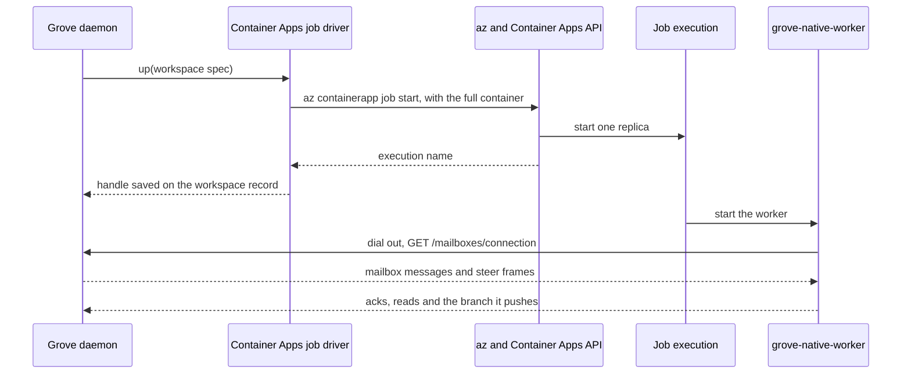

# Container Apps job

## One workspace, one manual execution

An Azure Container Apps job is a resident runtime: each workspace is one manual-trigger execution of a job you created. Grove starts, reads and stops executions, and the job and its history stay yours.



## How Grove drives it { .ms-h2-icon data-icon="flow" }

The job is the deployment, an execution is the workspace, and Grove reads every execution by its name.

- **You create the job once.** Grove emits a manual-trigger template for `az containerapp job create --yaml`. The daemon token is a job secret whose value you set, and the template only names it.
- **Each start carries the whole container.** A start override replaces the full template for that execution, so Grove always sends the complete container rather than a delta.
- **Status is read by execution name.** Container Apps keeps only the latest hundred executions in its history, so reading by position would drift onto a stranger's execution.
- **An Azure Files share can be mounted** into each execution when you name one, for anything that should outlive the replica.
- **Nothing dials in.** The worker dials the daemon, so the job needs no ingress.

## Freeze, thaw and eviction { .ms-h2-icon data-icon="target" }

Container Apps has no suspend and offers no delete for an execution, so stop, freeze and remove all end it the same way.

- **Freeze stops the execution.** The worker pushes the branch first, and the branch is the saved state.
- **Thaw starts a new execution** from the frozen one's own template, read back from Azure and marked as a resume. The handle changes, and Grove saves the new one.
- **Remove stops the execution and leaves it in history.** A removed workspace may still read as stopped afterwards, never as running.
- **One execution runs until the replica timeout**, a day by default. When the platform ends it, the branch is what survives.
- **A quota or capacity refusal is final.** Grove surfaces it on the first answer and does not retry.

## Configuration { .ms-h2-icon data-icon="plug" }

```json title=".grove/config.json"
{
  "runtimes": {
    "azure": {
      "kind": "aca_job",
      "subscription": "00000000-0000-0000-0000-000000000000",
      "resource_group": "grove-rg",
      "environment": "grove-env",
      "job": "grove-workspaces",
      "image": "acme.azurecr.io/grove/runtime:latest"
    }
  }
}
```

`client_secret_env` names the variable holding the service principal secret. Every field is in the [Configuration Reference](configure-reference.md).

## See also

- [Runtimes](features-runtimes.md)
- [Lambda and Azure Functions](runtimes-lambda-azure-functions.md)
