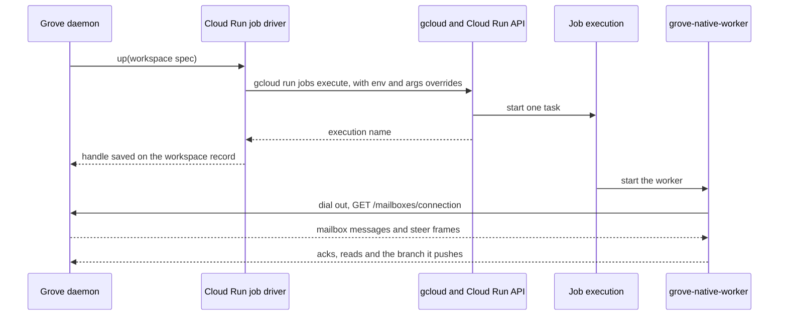

# Cloud Run job

## One workspace, one job execution

A Cloud Run job is a resident runtime: each workspace is one long-running execution of a job you deployed. Grove starts, reads, cancels and deletes executions of that job, and the job itself always stays yours.



## How Grove drives it { .ms-h2-icon data-icon="flow" }

The job is the deployment, an execution is the workspace. Grove never edits the job after you apply it.

- **You apply the job once.** Grove emits a job definition for `gcloud run jobs replace`, with one task, no retries and your configured CPU, memory and timeout. The daemon token arrives as a Secret Manager reference, never as a value in the document.
- **Each workspace is one execution.** `up` runs the job with per-execution env and args overrides, and the execution's name becomes the handle saved on the workspace record.
- **Status comes from the execution's own counters.** A completion time or any succeeded, failed or cancelled count reads as stopped, a running count as running, and anything earlier as starting. An execution that no longer exists reads as absent, and an unreadable one reads as unknown rather than a guess.
- **Nothing dials in.** The worker inside the execution dials the daemon, so the job needs no ingress at all.
- **Removing a workspace deletes its execution and leaves the job.** An execution that is already gone counts as removed.

## Freeze, thaw and eviction { .ms-h2-icon data-icon="target" }

Cloud Run has no suspend, so the pushed branch is the frozen state and a thaw is a fresh execution.

- **Freeze cancels the execution.** The worker pushes the branch first, and nothing else needs saving.
- **Thaw starts a new execution** with the frozen one's own overrides, read back from Cloud Run and marked as a resume, so the worker continues the session instead of starting one. The handle changes, and Grove saves the new one.
- **A thaw needs the old execution to still be readable.** If Cloud Run has already forgotten it, the thaw says so, and the remedy is a fresh workspace from the branch.
- **A quota or capacity refusal is final.** Grove surfaces the platform's answer and does not retry it.
- **One execution runs at most 168 hours**, Cloud Run's own task limit. When the platform ends it, the branch is what survives.

## Configuration { .ms-h2-icon data-icon="plug" }

```json title=".grove/config.json"
{
  "runtimes": {
    "gcp": {
      "kind": "cloud_run_job",
      "project": "acme-dev",
      "region": "us-central1",
      "job": "grove-workspaces",
      "image": "us-docker.pkg.dev/acme-dev/grove/runtime:latest",
      "daemon_token_secret": "grove-daemon-token"
    }
  }
}
```

`credentials_env` names the variable holding the driver's own credential file. Every field is in the [Configuration Reference](configure-reference.md).

## See also

- [Runtimes](features-runtimes.md)
- [Cloud Run service](runtimes-cloud-run-service.md)
