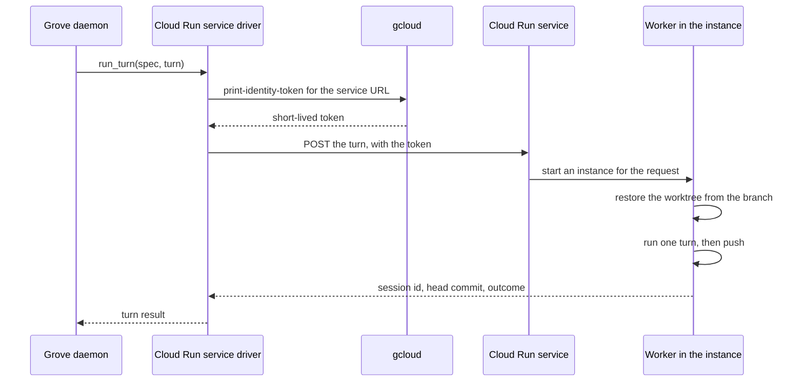

# Cloud Run service

## One turn, one authenticated request

A Cloud Run service is an episodic runtime: nothing runs between turns, and each turn is one request Grove sends to a service you deployed. An idle workspace here costs only the storage its branch takes.



## How Grove drives it { .ms-h2-icon data-icon="flow" }

Grove's own outbound request carries the turn, and the worker inside answers with the result before the instance goes away.

- **The service scales to zero between turns.** Grove emits a service definition for `gcloud run services replace`, and you deploy it with `--no-allow-unauthenticated`.
- **Who may invoke is IAM, not the document.** Grant `run.invoker` to the credential `credentials_env` names, and Grove mints an identity token for the service URL per turn. Nothing long-lived is held.
- **Each request restores, runs one turn, pushes and answers.** The first turn starts a session, and every later turn continues the session the previous result named.
- **The answer is small and the branch carries the work.** A result names the session, the head commit and the outcome, and nothing else.
- **No instance for the request is a refusal.** Grove surfaces it on the first answer and does not retry.

## Turn limits and what survives { .ms-h2-icon data-icon="target" }

There is nothing to freeze, so the only limit that matters is how long one turn may take.

- **A turn must finish inside one request**, at most 60 minutes on Cloud Run. Set `request_timeout_seconds` lower if your turns are shorter.
- **A turn cut short is a failure**, never a made-up result, because a synthesised answer would read as a turn that finished.
- **The branch is the truth.** The worker pushes what it had before it ended, and the next turn restores from there.
- **There is no mid-turn steer.** The only input an episodic workspace takes is the next turn.

## Configuration { .ms-h2-icon data-icon="plug" }

```json title=".grove/config.json"
{
  "runtimes": {
    "gcp-turns": {
      "kind": "cloud_run_episodic",
      "project": "acme-dev",
      "region": "us-central1",
      "service": "grove-turns",
      "url": "https://grove-turns-abc123-uc.a.run.app",
      "image": "us-docker.pkg.dev/acme-dev/grove/runtime:latest"
    }
  }
}
```

Every field is in the [Configuration Reference](configure-reference.md).

## See also

- [Runtimes](features-runtimes.md)
- [Cloud Run job](runtimes-cloud-run-job.md)
