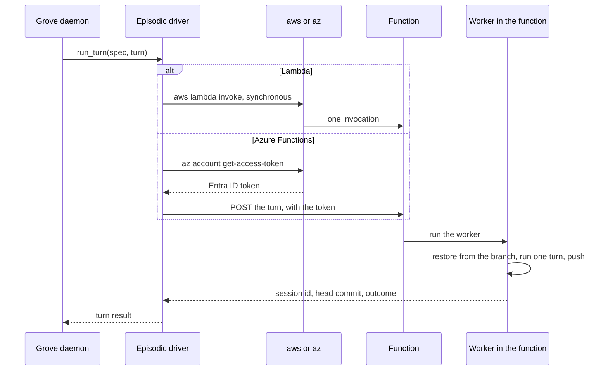

# Lambda and Azure Functions

## One turn, one invocation

Classic AWS Lambda and Azure Functions on Container Apps are episodic runtimes: each turn is one invocation of a function you deployed, and nothing runs between turns. They differ in how the turn is carried and how long it may take.



## Classic Lambda { .ms-h2-icon data-icon="flow" }

One synchronous invocation is one turn, and the function's own deadline is the hard edge.

- **A function runs at most 15 minutes**, so a turn must fit inside one invocation.
- **Lambda sends no SIGTERM**, so the worker must push before its own deadline. Whatever it pushed is what survives.
- **The response is capped at 6 MB**, which is why the result stays small and the branch carries the work.
- **A function error is a failure even though the call succeeded.** Lambda reports it beside a zero exit status, and Grove reads the two separately so it is never mistaken for a result.
- **A throttled invocation is a refusal.** Grove surfaces it and does not retry. The function's `/tmp` must be large enough to hold the restored worktree.

## Azure Functions on Container Apps { .ms-h2-icon data-icon="route" }

One HTTPS request is one turn, sent with an Entra ID token minted per turn.

- **You deploy the app once** from the emitted `kind: functionapp` template, with `az containerapp create --yaml`.
- **Grove mints a token per turn** with `az account get-access-token` for the application `token_resource` names, so nothing long-lived is held.
- **The app has no long-running guarantee**, so a turn must fit one request. Platform maintenance may end a replica with SIGTERM and then SIGKILL 30 seconds later.
- **No replica for the request is a refusal**, surfaced on the first answer.

## What both share { .ms-h2-icon data-icon="target" }

- **There is nothing to freeze.** An idle workspace costs only its branch, and the next turn is the thaw.
- **A turn cut short is a failure**, never a made-up result.
- **There is no mid-turn steer.** The only input is the next turn.
- **Every later turn continues the session** the previous result named.

## Configuration { .ms-h2-icon data-icon="plug" }

```json title=".grove/config.json"
{
  "runtimes": {
    "aws-turns": {
      "kind": "lambda_episodic",
      "region": "us-east-1",
      "function": "grove-turns",
      "image": "000000000000.dkr.ecr.us-east-1.amazonaws.com/grove-runtime:latest"
    },
    "azure-turns": {
      "kind": "aca_functions_episodic",
      "subscription": "00000000-0000-0000-0000-000000000000",
      "resource_group": "grove-rg",
      "environment": "grove-env",
      "app": "grove-turns",
      "url": "https://grove-turns.example.azurecontainerapps.io/api/turn",
      "image": "acme.azurecr.io/grove/runtime:latest",
      "token_resource": "api://grove-turns"
    }
  }
}
```

Every field is in the [Configuration Reference](configure-reference.md).

## See also

- [Runtimes](features-runtimes.md)
- [Lambda MicroVM](runtimes-lambda-microvm.md)
- [Container Apps job](runtimes-aca-job.md)
