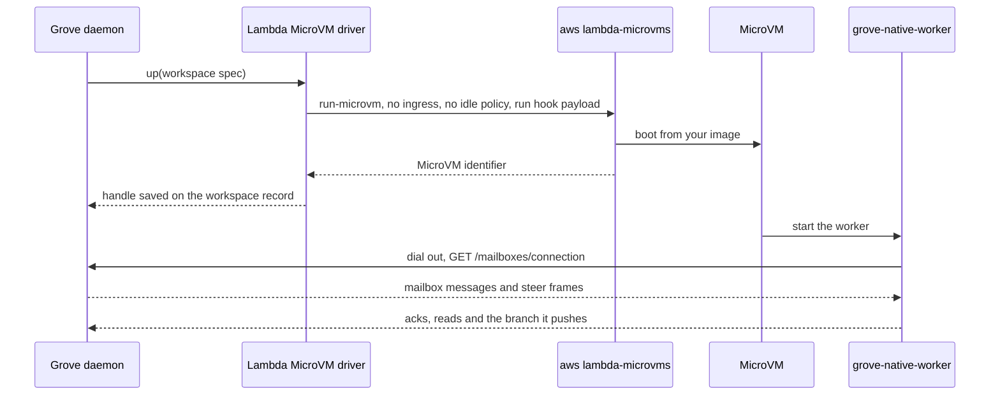

# Lambda MicroVM

## One workspace, one MicroVM that can really sleep

An AWS Lambda MicroVM is a resident runtime with native suspend and resume: each workspace is one MicroVM, and freezing it keeps memory and disk on the same machine. It is the only remote runtime where a thaw picks up exactly where the agent stopped.



## How Grove drives it { .ms-h2-icon data-icon="flow" }

Two launch choices matter more than any other, and both follow from the worker dialling out.

- **Inbound connectivity is off.** A MicroVM ships with a public endpoint by default, and Grove lets nothing dial in, so every MicroVM runs with the `NO_INGRESS` connector.
- **The platform's idle suspend is off.** It keys on endpoint traffic, which a dial-out worker never produces, so leaving it on would suspend a busy agent. Grove's own idle detection decides when to freeze.
- **Per-workspace facts ride the run hook payload.** Image-level environment is shared by every MicroVM of that image, so it cannot carry anything that belongs to one workspace.
- **You build the image once.** Grove emits the image definition plus the CloudFormation for its role, you build it with `create-microvm-image` from the runtime image, and the daemon token is a Secrets Manager ARN, never a value.
- **MicroVMs run on arm64 only**, so the runtime image must be built for it.

## Freeze, thaw and eviction { .ms-h2-icon data-icon="target" }

Freeze and thaw are the platform's own verbs on the same MicroVM, so the handle never changes.

- **Freeze suspends the MicroVM** with its memory and disk kept. Suspended time still counts against its lifetime.
- **Thaw resumes the same MicroVM**, and the agent continues from where it was.
- **A MicroVM lives at most eight hours**, running and suspended time together. When the platform ends it, the branch is what survives.
- **Stop terminates.** A MicroVM cannot be stopped and restarted, so stop and remove both release everything it holds.

## Configuration { .ms-h2-icon data-icon="plug" }

```json title=".grove/config.json"
{
  "runtimes": {
    "aws": {
      "kind": "lambda_microvm",
      "region": "us-east-1",
      "image": "arn:aws:lambda:us-east-1:000000000000:microvm-image/grove-runtime",
      "max_duration_seconds": 28800
    }
  }
}
```

`access_key_env`, `secret_key_env` and `daemon_token_secret_arn_env` name where the credentials live. Every field is in the [Configuration Reference](configure-reference.md).

## See also

- [Runtimes](features-runtimes.md)
- [Lambda and Azure Functions](runtimes-lambda-azure-functions.md)
