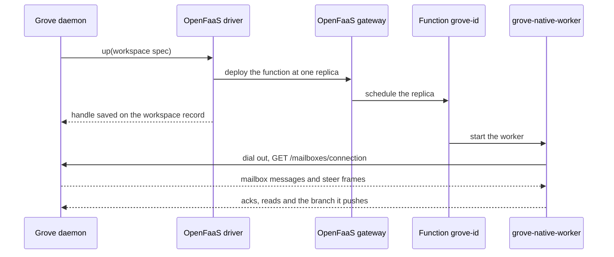

# OpenFaaS

## One workspace, one single-replica function

OpenFaaS is a resident runtime on a gateway you host: each workspace is one function named `grove-<id>`, pinned to one replica. Grove drives it through the gateway's own REST API.



## How Grove drives it { .ms-h2-icon data-icon="flow" }

The gateway's API is the verb surface, and the function itself is where Grove keeps the one fact a restart must not lose.

- **Grove deploys and redeploys the function.** It can also emit a `stack.yml` for `faas-cli deploy` if you prefer to apply it yourself.
- **Status comes from replica counts.** One available replica reads as running, zero replicas as stopped or frozen, and anything between as starting.
- **Stopped and frozen look the same to OpenFaaS**, so the function carries a `grove.state` label saying which. The function is the only thing that survives a daemon restart, so it is the only honest place to keep that fact.
- **The gateway timeout must cover the function's.** Set the gateway's `upstream_timeout` to at least the function's `exec_timeout`, a week by default.
- **Removing a workspace deletes its function.** One that is already gone counts as removed.

## Freeze, thaw and eviction { .ms-h2-icon data-icon="target" }

Freeze is scale to zero, and the function and its configuration stay in place for the thaw.

- **Freeze scales the function to zero** after the worker pushes its branch. Scale to zero is an OpenFaaS Pro feature.
- **Thaw scales it back to one replica**, marked as a resume. The handle stays the same, since it is the same function.
- **A thawed replica starts cold.** Memory is not kept, so the worker resumes from the pushed branch.
- **Stop is also scale to zero** with a different label, so a stopped workspace never reads as frozen.

## Configuration { .ms-h2-icon data-icon="plug" }

```json title=".grove/config.json"
{
  "runtimes": {
    "faas": {
      "kind": "openfaas",
      "gateway_url": "https://faas.example.com",
      "image": "registry.example.com/grove/runtime:latest",
      "password_env": "OPENFAAS_PASSWORD"
    }
  }
}
```

The gateway is reached with basic auth, the password read from the variable `password_env` names. Every field is in the [Configuration Reference](configure-reference.md).

## See also

- [Runtimes](features-runtimes.md)
- [OpenSandbox](runtimes-opensandbox.md)
