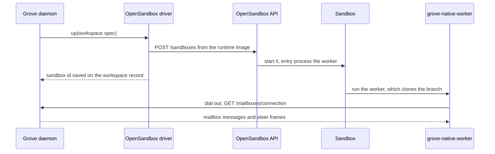

# OpenSandbox

## A sandbox service you host, as a resident runtime

OpenSandbox is a self-hosted sandbox-as-a-service stack. Each workspace is one sandbox created from the Grove runtime image, and Grove drives it through the server's own lifecycle API. The worker inside dials the daemon exactly as it does on every other resident platform.



## How a workspace maps onto a sandbox { .ms-h2-icon data-icon="flow" }

One workspace is one sandbox, and the sandbox id is the only thing Grove needs to find it again.

- **Up creates a sandbox** whose entry process is the worker. The worker clones your repository and checks out the workspace branch itself, so nothing dials into the sandbox.
- **Outbound traffic is denied by default.** The sandbox may reach the daemon, your git host and the hosts you list in `allow_hosts`, such as your model API. Grove never relies on the server's own default. Each name is allowed together with the addresses it resolves to when the sandbox is created, because a server that enforces egress at both the DNS and the firewall layer drops a connection to an address it was not told about. An address can front several services, so that layer is wider than the name.
- **Status reads the sandbox's own state**, and a server that does not answer reads as unknown rather than a guess.
- **A quota or capacity refusal is final.** The server's quota and pool answers are reported as a refused create and never retried.
- **Removing a workspace deletes its sandbox.** One that is already gone counts as removed.

## Freeze, thaw and eviction { .ms-h2-icon data-icon="target" }

OpenSandbox can pause a sandbox but cannot stop one and keep it, so both freeze and stop are a pause.

- **Freeze pauses the sandbox in place** after the worker pushes its branch. Memory stays resident, so a thaw picks the agent up mid-thought.
- **Stop is also a pause**, marked in the sandbox's metadata so a stopped workspace never reads as frozen.
- **Thaw resumes the same sandbox.** Its id is stable across pause and resume, so the handle never changes.
- **A host reboot loses a paused sandbox** on the Docker backend. A thaw that finds it gone starts a fresh sandbox on the pushed branch with a new session, since the conversation lived inside the old one.
- **A workspace frozen for a while longer hibernates.** Grove snapshots the sandbox, pushes a `snap-` tag to the runtime image repository and only then deletes the sandbox, so it holds no memory and no local disk. Set `snapshot_registry` only to override that repository. The next message restores the same session and keeps the snapshot until the worker reconnects, so a failed restore can be retried.

## Configuration { .ms-h2-icon data-icon="plug" }

```json title=".grove/config.json"
{
  "runtimes": {
    "sandbox": {
      "kind": "opensandbox",
      "image": "registry.example.com/grove/runtime:latest",
      "url_env": "OPEN_SANDBOX_URL",
      "api_key_env": "OPEN_SANDBOX_API_KEY",
      "image_auth_user_env": "REGISTRY_USER",
      "image_auth_password_env": "REGISTRY_PASSWORD",
      "resources": {"cpu": "2", "memory": "4Gi"},
      "allow_hosts": ["api.example.com"],
      "registry_user_env": "REGISTRY_USER",
      "registry_password_env": "REGISTRY_TOKEN"
    }
  }
}
```

The server URL and API key are read from the variables `url_env` and `api_key_env` name, and the driver adds the `/v1` API path itself. A runtime image in a private registry takes its credential from the two `image_auth_*_env` variables. `resources` is required, because the server refuses a sandbox with no limits. Leave `timeout_seconds` unset for a sandbox that never expires. Hibernation needs a `docker` client reaching the same engine as the OpenSandbox server, and `idle.hibernate_after_seconds` sets how long a frozen workspace waits, 0 to never hibernate. Every field is in the [Configuration Reference](configure-reference.md).

Grove verifies the server's TLS certificate with the Python 3.13+ strict X.509 rules and never relaxes them, so a self-hosted stack behind a private CA needs a CA certificate whose Basic Constraints extension is marked critical. A failure reads `Basic Constraints of CA cert not marked critical` on the first create, while the snapshot push is unaffected because the `docker` client verifies on its own, and re-issuing the CA repairs every client on the network. [Add the root to Grove's trust](configure-project.md) through the `GROVE_TLS_CA_PATH` variable when the operating system store does not already carry it.

## See also

- [Runtimes](features-runtimes.md)
- [OpenFaaS](runtimes-openfaas.md)
