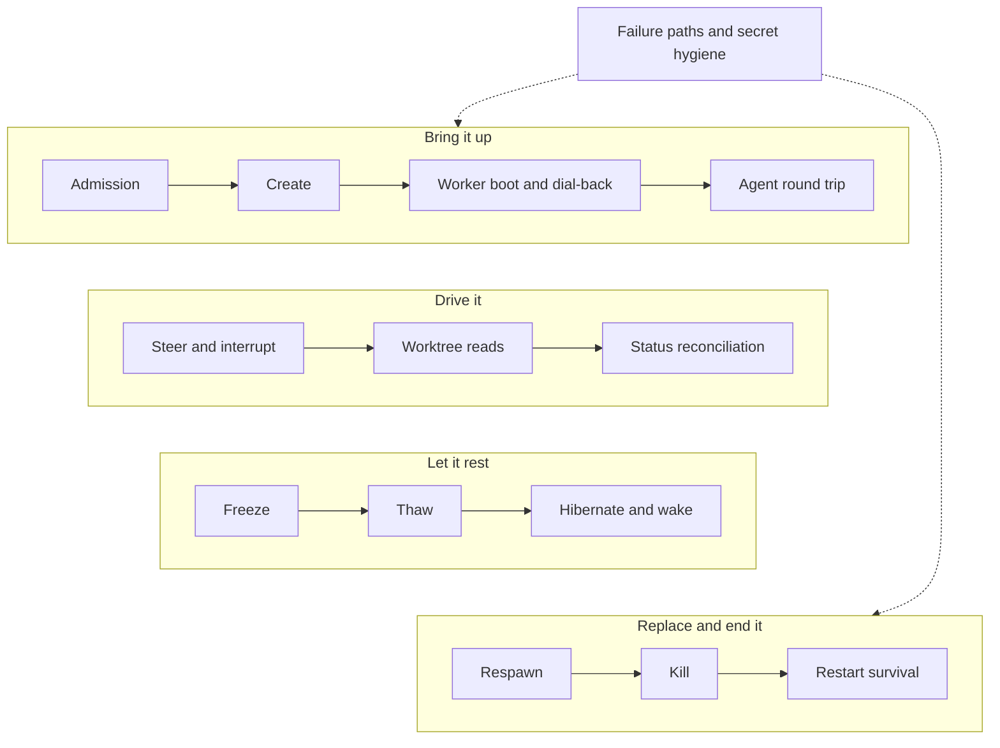

# Verifying a Remote Runtime

## Walk one workspace through every leg before you trust it

A remote runtime is only proven once one real workspace has lived its whole life on it. Unit tests prove each driver verb against a faked platform, but only a live pass can show the image pulls, the egress lets the clone through and the worker finds its way back. Think of it as a flight checklist: the same legs in the same order every time, each with a gauge you read rather than a feeling you trust.



## The legs, in order { .ms-h2-icon data-icon="flow" }

Each leg depends on the one before it, so a failure early on tells you where to look rather than leaving later legs to fail for a reason they did not cause.

- **Admission refuses before anything exists.** A create naming an unknown runtime, a terminal agent, a daemon with no `daemon.mailbox_url` or a repository with no remote is turned away with nothing built, because a worker in that position could never dial back.
- **Create and boot prove the platform half.** The workload starts from your image with its resource limits, the worker clones the workspace branch through the egress allowlist, and the workspace reads active once the worker has connected.
- **The round trip and the steer prove the agent half.** A message comes back as a reply in the transcript, and a steer sent mid-task reaches the worker. A delivered receipt only says Grove handed the text over, so read the worker's own output for the effect.
- **Freeze, thaw, hibernate and wake prove nothing is lost while it rests.** The branch is pushed before the workload pauses, and the conversation picks up where it left off after a wake. Set a codeword before the rest and ask for it after.
- **Respawn, kill and a daemon restart prove the edges.** Respawn starts a fresh session on the pushed branch, kill leaves no workload, no record and no worker credential behind, and a restarted daemon finds its remote workspace again.

## Evidence you read, not infer { .ms-h2-icon data-icon="target" }

Every item is checked by reading a value from somewhere you can point at, so two people walking the same leg reach the same verdict.

- **The workspace record is the first gauge.** `GET /workspaces/<id>` carries the status, the platform handle, and the `frozen_at` and `hibernated_at` stamps the resting legs set and clear.
- **The platform's own view is the second.** The workload's state and its stdout come from the platform's console or API, never from Grove, because a leg passes only when both sides agree.
- **Git is the third, for anything about work surviving.** `git ls-remote origin <branch>` against the workload's own HEAD settles whether a freeze or a respawn kept the commits.
- **Absence is checked as carefully as presence.** After kill, the platform lists no workload, `grove ls` has no row and `grove auth sessions` has no `worker-<id>` session.
- **Secrets are checked by searching for them.** Grep the emitted spec, the daemon journal, the workspace history and the store for every credential's value after a full pass. Grove keeps only a hash of each worker credential, so search for the `grove_v1_` prefix every one of them begins with. A clean grep is the only evidence that none of them leaked.

## The checklist lives on the tracker { .ms-h2-icon data-icon="book" }

This page is the method, and the project's tracker holds the live checklist. That issue groups the same legs into checkboxes, names the exact command for each item and marks which ones have passed on a real platform. Run a pass, paste the values you read into a comment on that issue, and tick only what the values prove.

- **One pass per platform release or driver change.** A new image, a new egress rule or a driver fix earns a fresh pass of every leg it could touch.
- **The runtime image is a deployment of its own.** The worker is built into the image, so a worker fix reaches a pass only after the image is rebuilt and retagged and the daemon restarted to read the new tag. A worker that boots and answers yet never shows the fix is running the old image.
- **Budget the resting legs for real sizes.** A snapshot carries the workload's home and worktree. Its `snap-` tag shares the runtime image repository by default, so a registry can reuse the runtime's base layers. Every wake still pulls the snapshot before restoring it.
- **Use a disposable repository with a plain HTTP remote** when the sandbox image carries no private certificate authority, so the clone is not the thing under test.
- **Never paste a credential into the comment.** The hygiene leg exists to prove none appear, and a pasted one fails it on the spot.
- **A leg blocked on an open issue stays unticked and says which issue**, so the next pass knows what to retry.

## Configuration { .ms-h2-icon data-icon="plug" }

A pass needs one resident runtime block, a daemon the workload can reach, and a native agent. The daemon address is host configuration, so it lives in your user config and a repository never sets it. A forge that requires authentication to push also needs `worktree.push_token_env`, or every freeze refuses because the branch cannot be pushed first.

```json title="~/.config/grove/config.json"
{
  "daemon": {"mailbox_url": "http://grove.example.com:7421"}
}
```

```json title=".grove/config.json"
{
  "runtimes": {
    "sandbox": {
      "kind": "opensandbox",
      "image": "registry.example.com/grove/runtime:latest",
      "url_env": "OPEN_SANDBOX_URL",
      "api_key_env": "OPEN_SANDBOX_API_KEY",
      "resources": {"cpu": "2", "memory": "4Gi"},
      "allow_hosts": ["api.example.com"]
    }
  }
}
```

Create the workspace with `grove create --runtime sandbox` and walk the legs above. Every field for every runtime kind is in the [Configuration Reference](configure-reference.md).

## See also

- [Runtimes](features-runtimes.md)
- [OpenSandbox](runtimes-opensandbox.md)
- [Idle Suspension](features-idle.md)
