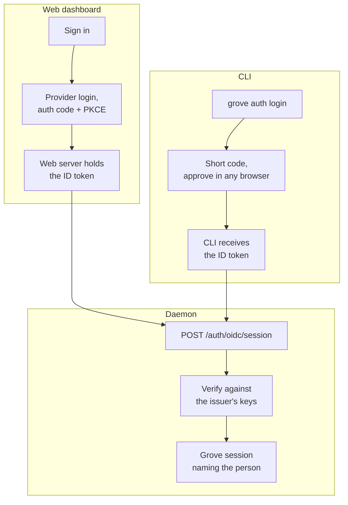

# Authentication & pairing

## Pair a device with Grove

The [web dashboard](use-webapp.md) talks to a real HTTP daemon, so it needs to know who is calling.
Grove borrows the model your headphones already use: a new device asks to connect, both sides show
the same short code, and you approve it on the host. The daemon binds loopback, and pairing is how a
device earns access.

## The handshake

Pairing is a three-step handshake, out of band, and a browser's first visit lands on a pairing screen.

- **Step one, on the device.** Edit the suggested label, such as "Pixel 8", then request pairing. The daemon returns a code.
- **Step two, on the device.** The browser shows an eight-character code, `XXXX-XXXX`, and polls. Compare it against the host before approving.
- **Step three, on the host.** Confirm the matching code. Approval redirects the browser into the dashboard.

<div class="swiper ms-shots">
  <div class="swiper-wrapper">
    <div class="swiper-slide">
      <figure>
        
        <figcaption>Step 1, on the device. Name it, then request pairing.</figcaption>
      </figure>
    </div>
    <div class="swiper-slide">
      <figure>
        
        <figcaption>Step 2, on the device. The code to confirm on the host, expiring after five minutes.</figcaption>
      </figure>
    </div>
    <div class="swiper-slide">
      <figure>
        
        <figcaption>Step 3, on the host. The TUI pops this modal on its own: approve with <kbd>a</kbd>, deny with <kbd>d</kbd>.</figcaption>
      </figure>
    </div>
  </div>
  <div class="swiper-pagination"></div>
  <div class="swiper-button-prev"></div>
  <div class="swiper-button-next"></div>
</div>

## Approving on the host

Both ways to approve run on the host, since approval never travels over HTTP: the TUI's own modal, or
the CLI on a headless host.

```bash
grove auth pending                 # list requests; each line shows the code
grove auth approve <challenge-id>  # approve the matching one
grove auth deny <challenge-id>     # reject it
```

Approve only when the codes match. That single check stops someone who merely reached the pairing
screen. The code expires after five minutes, and the device starts over.

## Managing sessions

A session lasts thirty days, renewing on every use, so a daily device pairs once.

```bash
grove auth sessions                # active sessions with labels and expiry
grove auth revoke <session-id>     # lock a device out until it pairs again
```

The full reference lives on the [CLI page](use-cli.md#grove-auth).

## Sign in as a person

Pairing names a device. When several people share one Grove, or several daemons sit behind a [federation](features-federation.md) hub, Grove needs to know which person is asking, so it signs people in with your organisation's OpenID Connect provider instead.



- **The browser uses the authorization code flow with PKCE.** The dashboard's web server is the client, and the browser only ever sees redirects and its own `HttpOnly` session cookie.
- **The CLI uses the device flow.** `grove auth login` prints a short code and a URL, you approve it in any browser, and the CLI saves the resulting Grove session with owner-only permissions so every local client acts as you. `grove auth logout` forgets it.
- **The daemon trusts nothing it did not verify.** Both flows hand the ID token to the daemon once, it checks the signature against the issuer's published keys, and it answers with an ordinary Grove session. A forged token fails there, whatever the client claimed.
- **Any OIDC provider works.** Grove reads the issuer's discovery document, and it picks up a rotated signing key on the next sign-in without a restart.
- **Daemons never sign in this way.** Federated daemons trust each other through their own per-node key, so a person's login plays no part in daemon-to-daemon calls. In a federation, device pairing is refused, because a paired device names no person.

## Mine and everyone

Every workspace records who created it. The fleet opens on yours, and one filter widens it.

- **The fleet starts on what you created.** A workspace made under your sign-in carries your name, and one made by the host's own user reads as `local`.
- **Everyone's workspaces is a view, not a permission.** The filter in the fleet menu shows every person's workspaces, and turning it off hides nothing anyone is forbidden to read.
- **Everyone may read every workspace.** Sign-in answers "who is asking" for attribution and federation. It does not partition the fleet.
- **Without OIDC nothing changes.** A host with no issuer configured keeps device pairing exactly as above.

## The security model

Grove's access control rests on keeping the daemon private and letting people in by hand.

- **Loopback by default.** `grove daemon serve` binds `127.0.0.1`, no blessed `--host 0.0.0.0`. Reach it from elsewhere by forwarding a port over SSH. See [reaching the dashboard from outside](use-webapp.md#reaching-it-from-outside-the-network).
- **Only two open endpoints.** `/healthz` and the pairing handshake answer without a session. Every other endpoint needs a session token as `Authorization: Bearer`.
- **Approval cannot cross the wire.** The daemon exposes deny over HTTP, never approve, so only the host's TUI or CLI can grant a request.
- **Secrets stay where they belong.** Session tokens live only as SHA-256 hashes, in `${user_config_dir}/grove/auth.json`, mode `0600`. The plaintext token reaches the device once, never touching disk. In the browser it never appears: the server holds it, giving an `HttpOnly` cookie.

## Configure sign-in

OIDC is off until an issuer is set. `grove web` passes the issuer and client id to the dashboard's server, and a confidential client's secret is read from that server's environment only, as `GROVE_OIDC_CLIENT_SECRET`, so it never reaches the daemon or the browser.

```json title="~/.config/grove/config.json"
{
  "auth": {
    "oidc": {
      "issuer": "https://login.example.com",
      "client_id": "grove"
    }
  }
}
```

`audience` defaults to the client id. Every field is in the [Configuration Reference](configure-reference.md).

## See also

- [Federation](features-federation.md): how daemons trust each other.
- [Web dashboard](use-webapp.md): what the paired session unlocks.
- [CLI](use-cli.md#grove-auth): the `grove auth` command group.
